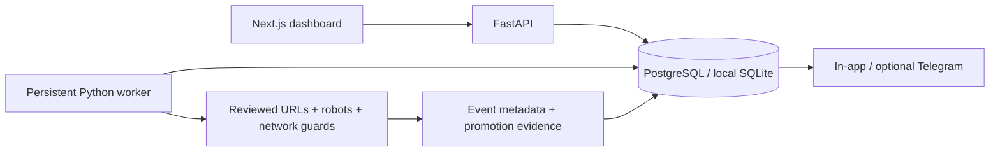

# Architecture

Next.js serves the dashboard and forwards `/api/*` to FastAPI. FastAPI exposes public discovery data and token-protected administrator operations. SQLAlchemy stores the frontier, events, candidates, evidence, reviews, watches and alerts. Alembic initializes and evolves the schema.

The separate Python worker polls the database, atomically claims a queued job, checks robots, fetches one page at a time, extracts JSON-LD and explicit promotions, and commits checkpoints. One nullable unique active slot prevents duplicate active scans. A ten-minute stale lease can be recovered. No Redis is needed for the supported single-worker deployment.

Deployments must keep the worker and API on the same database. PostgreSQL should use a migration role separately from a least-privilege runtime role. No Supabase service is configured. PostgreSQL portability is provided; runtime PostgreSQL validation remains outstanding. API timestamps are UTC, including SQLite values converted back to timezone-aware serialized timestamps.
